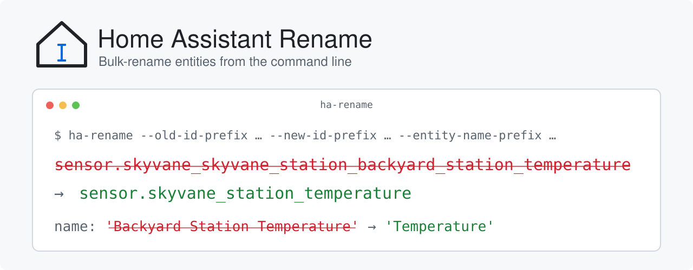

<picture>
  <source media="(prefers-color-scheme: dark)" srcset="assets/banner-dark.svg">
  
</picture>

---

[](https://github.com/sfelf/homeassistant-rename/releases/latest)
[](https://github.com/sfelf/homeassistant-rename/actions/workflows/tests.yml)
[](https://codecov.io/gh/sfelf/homeassistant-rename)
[](https://github.com/sfelf/homeassistant-rename/blob/main/pyproject.toml)
[](LICENSE)

Bulk-rename [Home Assistant](https://www.home-assistant.io/) entities from the command line.

Some integrations create entities with long, repetitive IDs and names. For example,
a weather-station integration can produce entities like `sensor.skyvane_skyvane_station_backyard_station_temperature`
named "Backyard Station Temperature". Renaming dozens of these by hand in the UI is tedious.
`ha-rename` does it in one command through Home Assistant's WebSocket API.

## What it does

For every entity in the entity registry whose ID (the part after `<domain>.`) starts
with `--old-id-prefix`:

1. **Entity ID:** the old prefix is replaced with `--new-id-prefix`.
   `sensor.skyvane_skyvane_station_backyard_station_temperature` → `sensor.skyvane_station_temperature`
2. **Name:** if the entity's name starts with `--entity-name-prefix`, that text is
   removed (along with any whitespace after it).
   `Backyard Station Temperature` → `Temperature`

Details:

- The name used is the one you set in Home Assistant if there is one, otherwise the
  name the integration supplied. Name matching is case-sensitive. Names that would
  become empty are left alone.
- Entities whose name comes from their device (`has_entity_name`) are flagged in the
  output. To change those names, rename the device in Home Assistant instead.
- Entities that don't match `--old-id-prefix` are never touched.
- If one update fails (for example because the new entity ID is already taken), the
  error is printed and the remaining entities are still processed. The exit code is
  then 1.

Changes are applied by default. **Always run with `--dry-run` first** to check what
will change.

## Requirements

- Python 3.11 or newer
- A Home Assistant instance you can reach over the network
- A Home Assistant user with administrator rights (needed to edit the entity registry)

## Installation

Install a release (see [Releases](https://github.com/sfelf/homeassistant-rename/releases)
for the latest version) with [uv](https://docs.astral.sh/uv/):

```bash
uv tool install git+https://github.com/sfelf/homeassistant-rename.git@v0.1.0
```

Or with [pipx](https://pipx.pypa.io/):

```bash
pipx install git+https://github.com/sfelf/homeassistant-rename.git@v0.1.0
```

Either command puts `ha-rename` on your `PATH`. To move to a newer release, run the
same command with the new version and `--force`, for example
`uv tool install --force git+https://github.com/sfelf/homeassistant-rename.git@v0.2.0`.

To try the latest unreleased changes instead, leave off the `@v…` suffix. Each release
also has a wheel attached, which you can install directly with
`uv tool install <wheel URL>`.

## Getting an access token

`ha-rename` signs in with a Home Assistant **long-lived access token**:

1. In Home Assistant, click your user name at the bottom of the sidebar to open your
   profile.
2. Open the **Security** tab.
3. Under **Long-lived access tokens**, click **Create token**, give it a name
   (e.g. `ha-rename`), and copy the token. Home Assistant only shows it once.

The first time you run `ha-rename` against a Home Assistant URL, it asks for the
token. Your input is hidden. Once Home Assistant accepts the token, it is saved in
your operating system's keyring (macOS Keychain, Windows Credential Manager, or the
Secret Service/KWallet on Linux) and reused on later runs. Tokens are stored per URL
under the service name `ha-rename`, so you can use several Home Assistant instances.

If a token is rejected, it is not saved. If a saved token stops working (for example
because you deleted it in Home Assistant), rerun with `--reset-token` to enter a new
one. To remove a saved token completely, delete the `ha-rename` entry in your
keyring app, or run:

```bash
uvx keyring del ha-rename ws://homeassistant.local:8123/api/websocket
```

## Usage

```
ha-rename --old-id-prefix PREFIX --new-id-prefix PREFIX --entity-name-prefix TEXT
          [--ha-url URL] [--dry-run] [--reset-token]
          [--print-completion SHELL] [--version] [-h]
```

### Example

Preview the changes:

```bash
ha-rename --dry-run \
  --old-id-prefix skyvane_skyvane_station_backyard_station_ \
  --new-id-prefix skyvane_station_ \
  --entity-name-prefix "Backyard Station"
```

```
Found 3 matching entities

sensor.skyvane_skyvane_station_backyard_station_temperature
  -> sensor.skyvane_station_temperature
  name: 'Backyard Station Temperature' -> 'Temperature'
switch.skyvane_skyvane_station_backyard_station_heater
  -> switch.skyvane_station_heater
  name: 'Backyard Station Heater' -> 'Heater'
sensor.skyvane_skyvane_station_backyard_station_humidity
  -> sensor.skyvane_station_humidity
  name: uses device name as prefix (rename the device instead)

Dry run only; nothing changed.
```

When you're happy with the preview, run the same command without `--dry-run`.

### Options

| Option | Required | Description |
| --- | --- | --- |
| `--old-id-prefix PREFIX` | yes | Entity ID prefix to match and replace, e.g. `skyvane_skyvane_station_backyard_station_`. Matched against the part of the ID after `<domain>.`. Lowercase letters, digits and underscores only. |
| `--new-id-prefix PREFIX` | yes | Replacement for the old prefix, e.g. `skyvane_station_`. Pass `""` to remove the old prefix. Lowercase letters, digits and underscores only. Must end with `_` exactly when `--old-id-prefix` does; otherwise the tool stops with an error, since the IDs would run together (`skyvane_stationtemperature`) or get a double underscore. |
| `--entity-name-prefix TEXT` | yes | Text to remove from the start of matching entity names, e.g. `"Backyard Station"`. Quote it if it contains spaces. |
| `--ha-url URL` | no | Home Assistant WebSocket API URL. Default: `ws://homeassistant.local:8123/api/websocket`. Use `wss://<host>/api/websocket` if Home Assistant is served over HTTPS (e.g. via Nabu Casa or a reverse proxy). |
| `--dry-run` | no | Show what would change without changing anything. |
| `--reset-token` | no | Ignore the saved access token and ask for a new one. The new token replaces the saved one once Home Assistant accepts it. |
| `--print-completion SHELL` | no | Print a tab-completion script for `bash`, `zsh`, `fish`, `tcsh` or `powershell`, then exit. |
| `--version` | no | Print the version and exit. |
| `-h`, `--help` | no | Show help, including all options and examples, then exit. |

### Exit codes

| Code | Meaning |
| --- | --- |
| 0 | Success (or dry run completed) |
| 1 | An error occurred: connection, authentication, keyring, or one or more failed updates |
| 2 | Invalid command-line arguments |
| 130 | Cancelled with Ctrl-C |

## Tab completion

Generate a completion script for your shell once:

**zsh**: make sure `~/.zfunc` is in your `fpath` before `compinit` runs in `~/.zshrc`
(`fpath=(~/.zfunc $fpath)`), then:

```bash
mkdir -p ~/.zfunc && ha-rename --print-completion zsh > ~/.zfunc/_ha-rename
```

**bash** (requires the `bash-completion` package):

```bash
mkdir -p ~/.local/share/bash-completion/completions && ha-rename --print-completion bash > ~/.local/share/bash-completion/completions/ha-rename
```

**fish**:

```bash
ha-rename --print-completion fish > ~/.config/fish/completions/ha-rename.fish
```

Then open a new shell.

## License

Copyright (C) 2026 Home Assistant Rename Contributors

This program is free software: you can redistribute it and/or modify it under the
terms of the GNU Affero General Public License as published by the Free Software
Foundation, either version 3 of the License, or (at your option) any later version.
See [LICENSE](LICENSE) for the full text.
